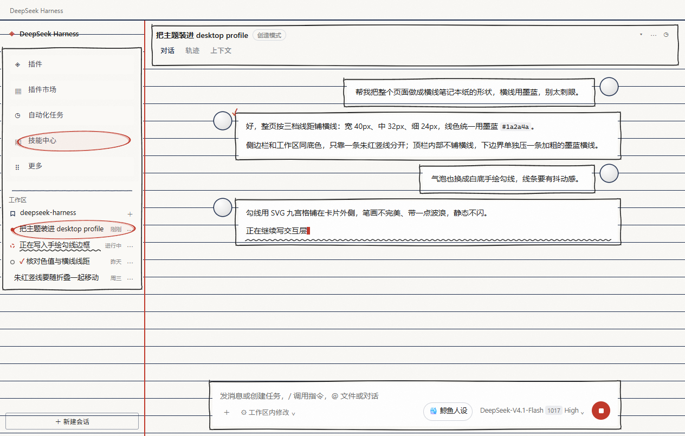
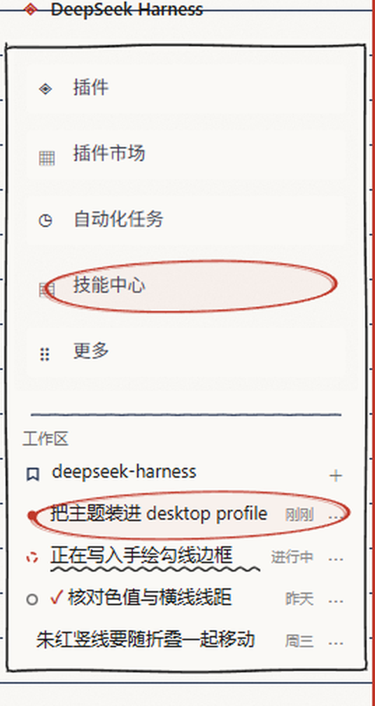
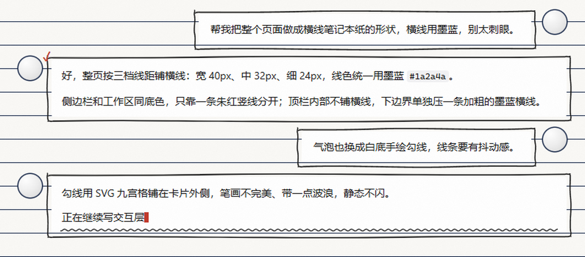
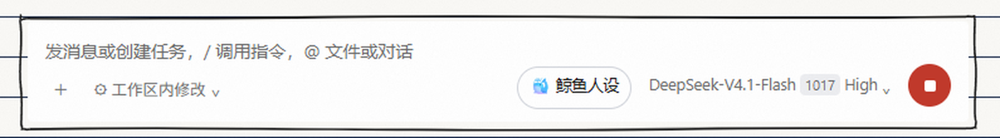
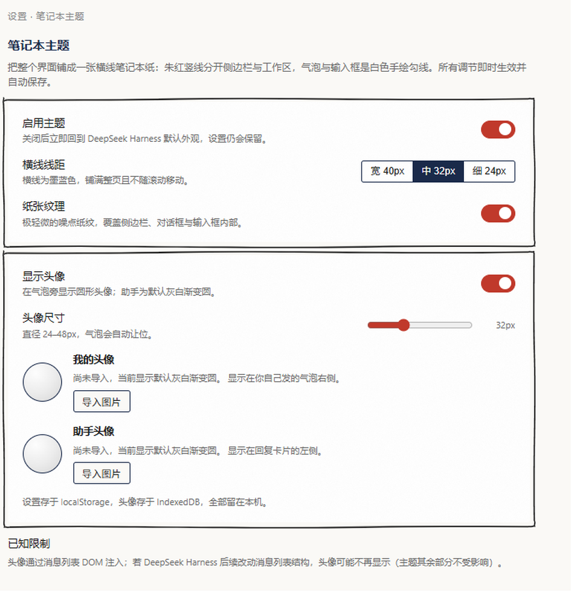

# 笔记本主题 · Notebook Paper Theme

> 把 DeepSeek Harness 桌面端铺成一张横线笔记本纸：纸色底、墨蓝横线、朱红竖线分栏，气泡与输入框是白色手绘勾线卡片，交互状态用手写批注（波浪线、朱红圈、对勾）表达。

适用于 **DeepSeek Harness 桌面端**（Desktop profile）。纯外观插件：不访问网络、不读写文件系统、不上传任何内容，设置与头像全部留在本机浏览器存储里。



> 预览图来自项目自带的结构预览页（按宿主真实 DOM 结构复刻），用于在不启动 Harness 的情况下核对样式。真机截图见 issue 区欢迎补充。

## 效果

| 位置 | 处理 |
| --- | --- |
| 页面 | 纸色 `#faf9f6` 铺满，墨蓝 `#1a2a4a` 横线跨整页对齐、滚动时不动；横线线距三档可调（宽 40 / 中 32 / 细 24px） |
| 纸纹 | 极轻噪点，覆盖侧边栏、对话框与输入框内部，可关 |
| 分栏 | 侧边栏右缘一条朱红 `#c0392b` 竖线，从顶栏下方开始，随折叠一起移动 |
| 顶栏 | 只铺纸纹不铺横线，下边界一条加粗墨蓝横线 |
| 侧边栏 | 「插件 / 插件市场 / 自动化任务 / 技能中心 / 更多」与整个工作区共用一个大手绘框，框内纯纸底；工作区标题上方一条半粗手绘分界线 |
| 会话头部 | 标题行 + 「对话 / 轨迹 / 上下文」标签行合成一个手绘框 |
| 气泡 / 输入框 | 白底（不铺纸色）+ SVG 九宫格手绘勾线，线条轻微抖动、静态无动效 |
| 消息 | 「我的」头像在气泡右侧、「助手」头像在回复卡片左侧；两张图各自可导入并裁剪，尺寸 24–48px 共用一个滑块 |

<p align="center">
  
  
</p>

<p align="center">
  
</p>

## 交互状态

侧边栏会话行与聊天消息共用同一套手写批注语言：

| 状态 | 表现 |
| --- | --- |
| 悬停 | 整行换成微暖纸色，文字上移 1px，下方波浪线从左到右画出（0.3s） |
| 选中 | 略倾斜的朱红手绘椭圆包住整行（聊天里包住整段文字，多行也是一个大椭圆） |
| 进行中 | 波浪线常驻并持续波动 |
| 进行中 + 选中 | 椭圆连波浪线一起包住 |
| 进行中 + 悬停 | 波浪线下方再加一条细直线 |
| 完成 | 朱红对勾 |

只有「悬停画出波浪线」与「进行中波浪线波动」两处有动效，手绘边框本身是静态图像。

## 安装

前置：已安装 **DeepSeek Harness 桌面端**。插件只装进桌面端 profile（Desktop profile），因此 `dsh web` 用默认 profile 启动时不会带这些样式；若在同一 profile 下跑 `dsh web`，样式同样会生效——这是主题本身的样式，没有为 Web 端做额外适配。

1. 克隆仓库到本地任意目录：

   ```bash
   git clone https://github.com/galizhajidanbaofan/dsh-theme-notebook-paper.git
   ```

2. 让 Harness 里的 AI 把它装成 bundle（推荐）：

   > 把 `D:\path\to\dsh-theme-notebook-paper` 装成插件

   它会调用 `plugin_manager` 完成安装，等价于手动执行：

   ```
   plugin_manager action=install_bundle target="D:\path\to\dsh-theme-notebook-paper"
   ```

   > 本地目录安装是软链：以后 `git pull` 更新后重启窗口即可生效，不需要重装。请不要手改 profile 的 `package.json` / `cordis.patch.yml`，也不要在 profile 目录里跑 pnpm。

3. 重启 DeepSeek Harness 桌面端（或重新加载窗口）。

4. 打开 **设置 → 笔记本主题**，主题即已启用。

卸载：`plugin_manager action=remove_bundle target=dsh-theme-notebook-paper`，然后刷新窗口。

### 从插件市场安装

本仓库同时提供了插件市场索引，Harness 内可直接装：

1. 打开 **插件 → 发现**，点 **添加索引源**
2. 粘贴：

   ```
   https://cdn.jsdelivr.net/gh/galizhajidanbaofan/dsh-theme-notebook-paper@main/market/index.json
   ```

3. 列表里出现「笔记本主题」后点 **安装**，重启窗口生效。

市场条目装的是 Git 源（按下述索引文件里的 commit 固定），与上面的 `git clone` 软链安装二选一即可，装的是同一个包。

> 索引本身也放在仓库里（`market/index.json`），原始地址是 `https://raw.githubusercontent.com/galizhajidanbaofan/dsh-theme-notebook-paper/main/market/index.json`。上面给的是 jsDelivr 镜像：有些网络里 Harness 的 Host（Node）抓 `github.com` / `raw.githubusercontent.com` 会报 `unable to verify the first certificate`，而 jsDelivr 走的是普通公共证书链，能正常读取。两条地址的内容一致，任选其一。

## 设置



- **启用主题**：总开关；关闭立刻回到默认外观，设置值保留
- **横线线距**：宽 40 / 中 32 / 细 24px
- **纸张纹理**：开 / 关
- **显示头像**：开 / 关
- **头像尺寸**：24–48px 滑块，两张头像共用
- **我的头像 / 助手头像**：导入 → 在弹层里拖动定位、滑杆缩放（1–3 倍）→ 输出 256×256 方形裁切；可重新裁剪或移除

所有调节项即时生效，没有保存按钮，也不会刷新页面。

## 数据与隐私

| 数据 | 位置 | 键 |
| --- | --- | --- |
| 开关与调节值 | `localStorage` | `dsh.notebook-paper.v1` |
| 我的头像 | IndexedDB `dsh-notebook-paper` / store `assets` | `avatar:user` |
| 助手头像 | 同上 | `avatar:assistant` |

图片只存在本机 IndexedDB 里，界面上用 `URL.createObjectURL` 临时取用，替换或卸载时立即 `revokeObjectURL`。插件不发起任何网络请求。清空站点数据会一并清掉设置与头像。

## 已知限制

1. **头像依赖消息列表 DOM 结构**：头像按 `[data-chat-flow-kind]` 等宿主属性注入，Harness 后续版本若改动消息列表结构，头像可能不再显示（其余外观不受影响）。
2. **手绘边框九宫格拉伸差异**：`border-image` 在不同 Chromium 版本里对中段的拉伸取整可能差一两个像素，长边波浪的频率会略有不同。
3. **侧栏行选中椭圆按行绘制**：会话标题特别长时，椭圆会比文字更宽。
4. **进行中的波浪线**依赖行内存在 `[data-state="ongoing"]` 标记；宿主改用别的表达方式时，该行会退回普通悬停波浪线。
5. **固定单亮色**：不注册暗色主题、不跟随系统配色；若被其它插件强制切到暗色，本主题仍按亮色渲染，可能出现对比度不足。

## 开发

宿主 DOM 变更后的自查方式：仓库自带一个结构预览页，不需要启动 Harness。

```bash
node dev/build.cjs          # 从 client.js 抽出 CSS 到 dev/notebook.css
# 然后用浏览器打开 dev/host-mock.html
```

预览页把宿主的真实类名与 DOM 层级（`AppFrame`、`panelList`、`regionArea`、`Lexical` 输入卡片、`[data-chat-flow-kind]` 消息行…）复刻成静态 HTML，打开页面即可核对样式；`?v=N` 可绕开缓存。`dev/` 只用于开发，不参与插件运行时。

实现细节（token 覆盖、CSS 视觉层、选择器稳定性、头像注入与清理）见 [docs/IMPLEMENTATION.md](docs/IMPLEMENTATION.md)。

```
package.json          bundle manifest（dsh.bundle.patch + dsh.client）
cordis.patch.yml      insert 一行 notebook-paper-theme
index.js              宿主半：纯外观，apply() 为空
client.js             客户端半：token 覆盖 + 全局 CSS + 设置面板 + 头像注入 + 清理
locale/zh.json        显示名「笔记本主题」
locale/en.json        Notebook Paper
icon.svg              64×64 图标
docs/                 预览图与实现说明
dev/                  结构预览页
```

## 许可

[MIT](LICENSE) © galizhajidanbaofan
